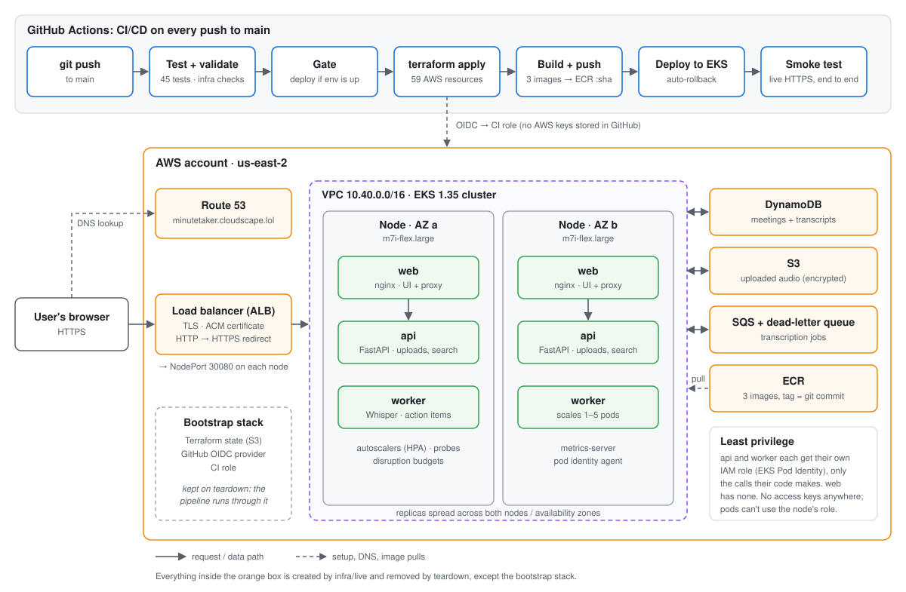

# MinuteTaker: Cloud Computing Project 3
### Infrastructure as Code and CI/CD (AI 255)

Project 2's MinuteTaker, rebuilt entirely from version-controlled code and deployed by a pipeline on every commit. It's a meeting recorder that returns a timestamped transcript plus the action items, with owners and due dates.

**Live (while the environment is up):** **[https://minutetaker.cloudscape.lol](https://minutetaker.cloudscape.lol)**

| | Project 2 | Project 3 |
|---|---|---|
| Kubernetes | local `kind` cluster, created by shell scripts | **Amazon EKS**, created by Terraform |
| Data services | DynamoDB, S3, SQS (Terraform) | same, now part of one environment that is torn down and rebuilt |
| AWS credentials for pods | long-lived IAM user access key | **EKS Pod Identity**: a separate short-lived role per service, no keys |
| Reaching the app | `http://localhost:8080` | **[https://minutetaker.cloudscape.lol](https://minutetaker.cloudscape.lol)**, served over HTTPS via an ALB, an ACM certificate and a Route 53 record |
| Build / deploy | by hand | **GitHub Actions** on every commit: test → build → apply → deploy → smoke test |

## Architecture



A push to `main` runs the pipeline across the top. It reaches AWS through OIDC, so no keys are stored. Users reach the app over HTTPS through Route 53 and the load balancer, and the pods on two EKS nodes in separate availability zones use DynamoDB, S3 and SQS through their own IAM roles.

## Repository layout
```
infra/bootstrap/   one-time: Terraform state bucket, GitHub OIDC provider, CI role (survives teardown)
infra/live/        the environment: VPC, EKS + nodes + add-ons, pod identity roles,
                   DynamoDB, S3, SQS (+DLQ), ECR, ALB, ACM certificate, DNS
k8s/base/          Deployments, Services, probes, HPAs, PDBs (from Project 2)
k8s/overlays/eks   the cloud deployment; overlays/local is the kind + moto dev setup
.github/workflows/ pipeline.yml (CI/CD on every push), teardown.yml (destroy + verify)
scripts/           smoke-test, verify-teardown, render-config, local dev scripts
services/          api, worker, web (from Project 2) and their tests
docs/report.md     design, decisions, measured teardown/rebuild, what didn't work
```

## The pipeline
| Trigger | What happens |
|---|---|
| Any push or pull request | unit tests (api, worker) · `terraform fmt` + `validate` · manifests checked against the Kubernetes 1.35 schemas (kubeconform) · shellcheck · on branches other than main, the 3 images are built |
| Push to `main` | all of the above, then `terraform apply` → images pushed to ECR tagged with the commit SHA → `kubectl apply` → wait for rollout (**automatic rollback** if a service doesn't become ready) → **end-to-end smoke test** against the live HTTPS URL |
| **Run workflow** on *pipeline* | same as a push to main; **rebuilds the environment from nothing** if it was torn down |
| **Run workflow** on *teardown* (type `destroy`) | `terraform destroy`, then `verify-teardown.sh` asks AWS directly that nothing is left |

Pushes to main while the environment is down still run all the CI checks. They skip the deploy rather than silently recreating a paid EKS cluster.

## Teardown and rebuild (the demonstration)
```bash
gh workflow run teardown -f confirm=destroy   # everything is deleted and verified gone
gh workflow run pipeline                      # rebuilt from code, deployed, smoke-tested
```
Or locally, with AWS credentials: `make destroy`, then `make apply`.

## First-time setup (already done for this repository)
```bash
make bootstrap                       # state bucket + OIDC role (local state, kept out of git)
gh workflow run pipeline             # builds the environment
make kubeconfig                      # kubectl access for the admin user
```

## Optional: developer checks on a laptop
The deployment is the AWS environment above. These commands are only for checking changes **before** pushing. They run the same tests and checks the pipeline runs, so a mistake is caught locally instead of in a failed pipeline run.
```bash
python3 -m venv .venv && .venv/bin/pip install -r services/api/requirements-dev.txt -r services/worker/requirements-dev.txt
make test        # the 45 unit tests the pipeline runs (AWS calls are mocked so tests cost nothing)
make lint        # the pipeline's static checks (Terraform, Kubernetes manifests, scripts)
```
`make up` still starts Project 2's local kind cluster for offline UI work. It isn't part of the Project 3 deployment.

**Report:** [docs/report.md](docs/report.md)
