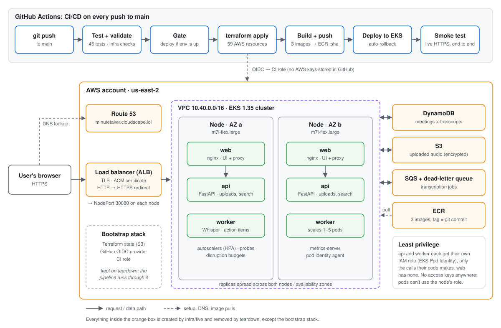

# MinuteTaker: Project 3 Report
### Infrastructure as Code and CI/CD

**Repository:** https://github.com/janahcodes/MinuteTaker-IaC
**Live URL:** https://minutetaker.cloudscape.lol
**Provider:** AWS, us-east-2.

## Summary

In Project 2, MinuteTaker ran on a local Kubernetes cluster that I created by hand, and it reached AWS with a stored access key. In Project 3:

- The whole environment is code: 59 AWS resources in Terraform, plus the Kubernetes manifests.
- It runs on Amazon EKS.
- A GitHub Actions pipeline tests, builds and deploys every commit, in about 4 minutes from push to live.
- The environment was destroyed (12 min) and rebuilt from nothing (16 min) by the pipeline.

## Requirements and evidence

| Requirement | Evidence |
|:--|:--|
| Reproduce the entire Project 2 environment | §1.2, `infra/live`, `k8s/` |
| From version-controlled infrastructure code | §1 |
| Pipeline builds | §2.1 |
| Pipeline tests | §2.2 |
| Pipeline deploys automatically on commit | §2.3, `evidence/commit-deploy-*` |
| Bad changes are stopped or rolled back | §2.4, `evidence/experiment*` |
| Environment is destroyable | §3.1, `evidence/teardown-1-*` |
| Environment is rebuildable from scratch | §3.2, `evidence/rebuild-1-*` |
| Demonstration: full teardown and rebuild | §3, §4 |

---

## 1. Reproducing the Project 2 environment from infrastructure code

### 1.1 Architecture

<p align="center"></p>

| What | Tool | Folder | Applied by |
|:--|:--|:--|:--|
| State bucket, GitHub login (OIDC), CI role | Terraform | `infra/bootstrap` | me, once |
| Network, EKS, nodes, IAM roles, DynamoDB, S3, SQS, ECR, load balancer, certificate, DNS | Terraform | `infra/live` | pipeline |
| Container images | Docker | `services/` | pipeline |
| Deployments, probes, autoscalers | Kubernetes | `k8s/` | pipeline |

### 1.2 Project 2 → Project 3

| Part | Project 2 | Project 3 |
|:--|:--|:--|
| Cluster | local `kind`, made by a script | EKS, 2 nodes in 2 availability zones |
| metrics-server | installed by hand | EKS add-on in Terraform |
| DynamoDB, S3, SQS, ECR | Terraform | Terraform, torn down and rebuilt with everything else |
| AWS access for pods | stored access key | no keys: each service gets its own role (EKS Pod Identity) |
| Web address | `http://localhost:8080` | https://minutetaker.cloudscape.lol |
| Kubernetes manifests | `k8s/base` | the same files, plus an EKS overlay |

Project 2 was not changed. Project 3 uses its own resource names, so the two don't clash.

### 1.3 Design decisions

**EKS.** My Project 2 report planned this move. EKS is managed Kubernetes, and it removes the stored key. The downside is a slower rebuild, because EKS takes about 12 minutes to create.

**Two Terraform stacks.** The pipeline needs a state bucket and an AWS role before it can run. If they were part of the environment, a teardown would delete them while using them. So they sit in a small `bootstrap` stack that is never torn down. Everything else is in `live`.

**No AWS keys anywhere.**
- GitHub signs in to AWS with OIDC. Only this repository's `main` branch is trusted.
- Each service gets only the AWS permissions its code uses. The web service gets none.
- Pods can't use the node's own AWS role.

**Load balancer in Terraform.** If Kubernetes created the load balancer, Terraform wouldn't know about it and couldn't delete it, so a teardown would fail. Creating it in Terraform keeps `terraform destroy` complete.

**HTTPS.** The record buttons need the microphone, and browsers only allow that on HTTPS sites.

**No NAT gateway.** It would cost about $33 a month. The nodes use public IPs instead, but only the load balancer can reach them.

### 1.4 Testing the infrastructure code

`terraform test` checks six design rules without touching AWS:
- everything can be destroyed
- 2 availability zones
- pods can't use the node's role
- only api and worker get AWS roles
- HTTPS only
- a bad domain name is rejected

All 6 pass. I also broke one rule on purpose, and its test failed.

---

## 2. Building, testing, and deploying automatically on commit

```
push → tests + checks → end-to-end test → terraform apply → build images → deploy → live test
```

### 2.1 Builds
Every push builds the three images. On `main`, they are pushed to ECR, tagged with the commit ID, so every running pod can be traced to its commit.

### 2.2 Tests

| Test | When |
|:--|:--|
| 45 unit tests (api and worker) | every push |
| Terraform format, validate and test | every push |
| Kubernetes manifest check | every push |
| End-to-end test: the built containers transcribe a real recording | every push, before deploy |
| Every pod runs the new commit | after deploy |
| Same end-to-end test on the live HTTPS site | after deploy |

### 2.3 Deploys automatically on commit
A push to `main` runs `terraform apply`, pushes the images, deploys to EKS and tests the live site, with no manual steps. If a service doesn't come up, the pipeline rolls everything back.

One push went from commit to a tested live site in **4 min 22 s** (`evidence/commit-deploy-*`).

If the environment has been torn down, pushes still run all the tests but skip the deploy, so a commit can't recreate the cluster by accident. Running the pipeline by hand rebuilds it.

### 2.4 Two deliberate bugs

**Experiment 1: a code bug.** I changed the code so owner names were saved in lowercase. The unit tests failed **41 seconds** after the push (`assert 'sarah' == 'Sarah'`). Nothing was deployed, and the live site stayed on the old version.

**Experiment 2: a deploy bug that passes every test.** I pointed the api's health check at a path that doesn't exist. All the tests passed, so it was deployed.
- The new api pod never became ready, and the old pods kept serving.
- After 7 minutes, the pipeline rolled back all services and marked the run as failed.

While this ran, I sent about 5 requests a second to the site for 15 minutes.
- **First run: 2,258 of 2,260 succeeded.** The 2 failures happened when web pods were being replaced. nginx was stopping before traffic moved away from it.
- **The fix:** a 10-second pause before a pod shuts down. Restarting all web and api pods twice then gave **499 of 499**.
- **Second run, with the fix: 2,229 of 2,229 succeeded**, with no failures during the bad deploy or the rollback (`evidence/experiment2-*`).

---

## 3. Destroying and rebuilding from scratch

### 3.1 Destroy
The `teardown` workflow runs `terraform destroy`. Then a script asks AWS directly whether 13 kinds of resources are gone.

Result: **59 resources destroyed in 12 min 8 s**, and all 13 checks said `gone` (`evidence/teardown-1-*`). Only the bootstrap stack is left.

### 3.2 Rebuild
Running the pipeline right after the teardown rebuilt everything (`evidence/rebuild-1-*`):

| Step | Time |
|:--|:--|
| Tests and checks | 36 s |
| End-to-end test of the built containers | 1 min 29 s |
| `terraform apply`: 59 resources created | 11 min 51 s |
| Build and push images | ~25 s |
| Deploy | 46 s |
| Live test passed | 11 s |
| **Total** | **15 min 41 s** |

---

## 4. Demonstrating a full teardown and rebuild

```bash
gh workflow run teardown --repo janahcodes/MinuteTaker-IaC -f confirm=destroy
gh workflow run pipeline --repo janahcodes/MinuteTaker-IaC
```

These can also be started from the repository's Actions tab. A full cycle takes about 28 minutes.

**The runs in §3 are the demonstration.** The teardown and the rebuild were both run through the pipeline, and their records are in `evidence/`.

---

## 5. Structure

- `infra/bootstrap`: what has to survive a teardown
- `infra/live`: the environment, split into network, EKS, data, permissions and the load balancer
- `k8s/`: the Project 2 manifests, plus an overlay for EKS
- `scripts/`: smoke test, teardown check, config, evidence, availability

---

## 6. Results

- **Transcription:** a 26-second recording was transcribed in about 1 second, with 5 action items found.
- **Autoscaling:** I uploaded 20 recordings at once, and all 20 were transcribed within about 20 seconds. Worker CPU reached 145%, so the autoscaler scaled the worker from 1 to 3 pods. After the 3-minute cooldown, it scaled back down to 1 (`evidence/autoscaling.txt`).
- **Permissions:** inside the live pods, each service's allowed calls worked, and calls outside its policy were refused. The web service has no AWS credentials, and pods can't reach the node's role (`evidence/permissions.txt`).
- **No drift:** on every deploy, Terraform reported "No changes".

---

## 7. What did not work

1. **GitHub couldn't sign in to AWS.** New GitHub repositories identify themselves with ID numbers, not just names. I updated the AWS role to match.
2. **The live test failed while the site was working.** Two bugs in my test script: a pipe that closed early, and Whisper writing "stand-up" instead of "standup". Both are fixed.
3. **The teardown check could never fail.**
   - The workflow piped the check through `tee` to save its output.
   - GitHub's default shell only looks at the last command in a pipe. That's `tee`, which always succeeds.
   - So even if resources were left over, the step would show green.
   - The fix: both workflows now use `shell: bash`, which turns on `pipefail`, so any failure in the pipe fails the step.
   - To test the fix, I ran the check while the environment was still up. It listed all 13 resource types as `LEFT` and failed, as it should.
4. **The first push didn't start the pipeline.** It most likely skipped because the last commit only changed docs. I started that run by hand. Every later push worked.
5. **"This site can't be reached" after the rebuild.** The site was fine. My Mac had saved the "not found" answer from during the teardown. Clearing the DNS cache fixed it.

## 8. Use of AI tools

I used Claude as an AI pair-programmer throughout this project.

**What the AI did:**
- Generated code and configured the necessary files and deployment scripts.
- Assisted in writing and organizing the GitHub README and report.md.
- Identified errors and suggested solutions.
- Reviewed project requirements and compared it to what was done.

**What I did:** 
- Selected the cloud services and planned the overall deployment architecture.
- Verified that the required cloud resources were created properly.
- Monitored deployment status and checked cloud resource configurations.
- Examined cloud logs to identify potential issues.
- Tested the deployed website across different devices.
- Compared actual results against expected results.
- Identified and documented bugs and areas for improvement.
- Identified unnecessary resources that could be removed.
- Tested the accuracy and functionality of the deployed website.
